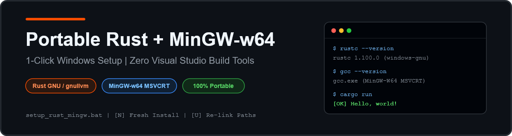

🌐 **Sprache / Language:** [Zurück zur Übersicht (`README.md`)](README.md) | [English Version (`README.en.md`)](README.en.md)

---

# Portables Rust + MinGW-w64 Setup für Windows (ohne Visual Studio Build Tools)

Dieses 1-Klick-Skript (`setup_rust_mingw.bat`) richtet eine vollständig portable Rust-Entwicklungsumgebung auf Basis von **MinGW-w64 (MSVCRT)** ein – ganz ohne die Installation der mehrere Gigabyte großen Visual Studio C++ Build Tools.

## Was das Skript installiert & konfiguriert
* **MinGW-w64 (GCC / POSIX-SEH / MSVCRT):** Wird per Windows-eigenem `tar.exe` in wenigen Sekunden direkt in deinen gewählten Zielordner unter `\mingw64` entpackt.
* **Rustup, Rustc & Cargo:** Werden portabel unter `\.rustup` und `\.cargo` installiert.
* **Defender- & Linker-Optimierung:** Richtet das Target `x86_64-pc-windows-gnullvm` ein, überbrückt `libunwind.a` mit `libgcc_eh.a` und verbindet den LLVM-Linker (`ld.lld.exe`) direkt mit den MinGW-Startobjekten (`crt2.o`, `crtbegin.o`).
* **Saubere Umgebungsvariablen:** Setzt `RUSTUP_HOME`, `CARGO_HOME` und die Benutzer-`Path`-Einträge dauerhaft und schreibt die globale `config.toml` im Format UTF-8 ohne BOM.

---

## Anleitung: In 3 Schritten zur fertigen Umgebung

### 1. Skript starten & Zielordner wählen
Starte die Datei **`setup_rust_mingw.bat`** per Doppelklick von einem beliebigen Ort aus (z. B. Desktop oder USB-Stick).
* Drücke **Enter**, um den Standardordner (`%USERPROFILE%\RustMinGW`) zu übernehmen.
* Oder gib einen eigenen Pfad ein (z. B. `D:\_DEV\_LIB`).
* *Wichtig:* Der Pfad darf **keine Leerzeichen** und keine Sonderzeichen (`!`, `&`) enthalten.

### 2. Modus auswählen
* **`[N]` Neu installieren:** Lädt MinGW-w64, Rustup und Cargo herunter und richtet alles frisch ein.
* **`[U]` Pfade erneuern:** Leitet nur die Umgebungsvariablen (`RUSTUP_HOME`, `CARGO_HOME`, `Path`) und die `config.toml` auf den gewählten Ordner um – ideal nach einem Umzug des Ordners oder einer Windows-Neuinstallation ohne erneuten Download.
* **`[A]` Abbrechen:** Beendet das Skript ohne Änderungen.

### 3. Automatischer Download & Browser-Fallback
Das Skript versucht zunächst, alle benötigten Dateien vollautomatisch im Hintergrund herunterzuladen und zu entpacken.
* **Falls eine Firewall oder ein Virenscanner den Hintergrund-Download blockiert**, greift automatisch der **Browser-Fallback**:
  1. Das Skript öffnet den direkten Download-Link in deinem Standardbrowser.
  2. Warte, bis der Download in deinem `Downloads`-Ordner abgeschlossen ist.
  3. Wechsle zurück in das Skript-Fenster und drücke **Enter** – das Skript übernimmt die Datei automatisch aus dem `Downloads`-Ordner und schließt die Einrichtung ab.

---

## Funktionsprüfung nach der Installation

Öffne nach Abschluss des Skripts ein **neues Terminal** (PowerShell oder Eingabeaufforderung) und teste die Umgebung mit einem kleinen Projekt:

```powershell
cargo new hello_rust
cd hello_rust
cargo run
```

Wenn **`Hello, world!`** ausgegeben wird, ist die Umgebung vollständig einsatzbereit.
