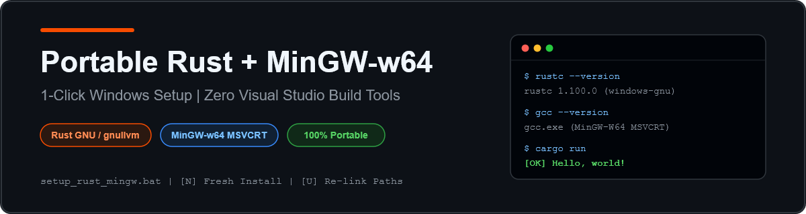

🌐 **Language / Sprache:** [Back to Overview (`README.md`)](README.md) | [Deutsche Version (`README.de.md`)](README.de.md)

---

# Portable Rust + MinGW-w64 Setup for Windows (No Visual Studio Build Tools)

This 1-click script (`setup_rust_mingw.bat`) sets up a fully portable Rust development environment powered by **MinGW-w64 (MSVCRT)**—eliminating the need to install multi-gigabyte Visual Studio C++ Build Tools.

## What the Script Installs & Configures
* **MinGW-w64 (GCC / POSIX-SEH / MSVCRT):** Extracted rapidly via Windows' built-in `tar.exe` directly into `\mingw64` inside your chosen directory.
* **Rustup, Rustc & Cargo:** Installed portably under `\.rustup` and `\.cargo`.
* **Defender & Linker Optimization:** Configures the `x86_64-pc-windows-gnullvm` target, bridges `libunwind.a` using `libgcc_eh.a`, and wires the LLVM linker (`ld.lld.exe`) directly to the MinGW startup objects (`crt2.o`, `crtbegin.o`).
* **Clean Environment Variables:** Permanently sets `RUSTUP_HOME`, `CARGO_HOME`, and user `Path` entries, and generates a global `config.toml` encoded as UTF-8 without BOM.

---

## How to Use: 3 Simple Steps

### 1. Launch the Script & Choose a Target Directory
Double-click **`setup_rust_mingw.bat`** from any location (e.g., Desktop or USB drive).
* Press **Enter** to accept the default location (`%USERPROFILE%\RustMinGW`).
* Or enter a custom directory path (e.g., `D:\_DEV\_LIB`).
* *Important:* The path must **not contain spaces** or special characters (`!`, `&`).

### 2. Select an Action Mode
* **`[N]` Fresh Install:** Downloads MinGW-w64, Rustup, and Cargo and sets up everything from scratch.
* **`[U]` Update Paths Only:** Re-links environment variables (`RUSTUP_HOME`, `CARGO_HOME`, `Path`) and `config.toml` to the selected folder—ideal after moving the folder or reinstalling Windows without re-downloading.
* **`[A]` Abort:** Exits the script without making any changes.

### 3. Automated Download & Browser Fallback
The script first attempts to download and extract all required archives silently in the background.
* **If a firewall or antivirus blocks background downloads**, the **Browser Fallback** triggers automatically:
  1. The script opens the direct download link in your default web browser.
  2. Wait until the file finishes downloading into your `Downloads` folder.
  3. Return to the script window and press **Enter**—the script automatically picks up the file from `Downloads` and completes the setup.

---

## Verifying the Installation

Once the script finishes, open a **new terminal** (PowerShell or Command Prompt) and verify the toolchain with a test project:

```powershell
cargo new hello_rust
cd hello_rust
cargo run
```

If **`Hello, world!`** appears in the console, your portable Rust environment is ready to use.
