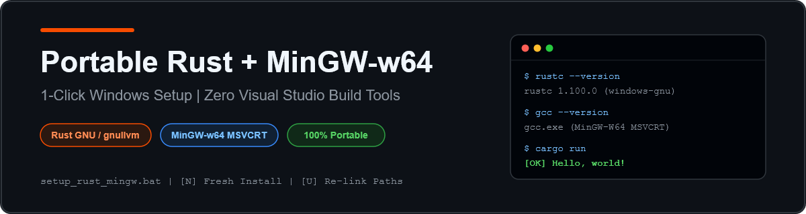

<div align="center">

🌐 **Language / Sprache:** [🇬🇧 English](#-english) • [🇩🇪 Deutsch](#-deutsch)

</div>

---

## 🇬🇧 English

A lightweight, **1-click batch installer** (`install_rust_mingw.bat`) that sets up a fully portable **Rust + MinGW-w64 (MSVCRT)** development environment on Windows—completely eliminating the need for multi-gigabyte Visual Studio C++ Build Tools.

> 📥 **Download English Installer:** **[`install_rust_mingw.bat`](install_rust_mingw.bat)** *(Click file → "Download raw file" on GitHub)*

### What the Script Installs & Configures
* **MinGW-w64 (GCC / POSIX-SEH / MSVCRT):** Extracted rapidly via Windows' built-in `tar.exe` directly into `\mingw64` inside your chosen directory.
* **Rustup, Rustc & Cargo:** Installed portably under `\.rustup` and `\.cargo` without touching global system folders.
* **Defender & Linker Optimization:** Configures the `x86_64-pc-windows-gnullvm` target, bridges `libunwind.a` using `libgcc_eh.a`, and wires the LLVM linker (`ld.lld.exe`) directly to the MinGW startup objects (`crt2.o`, `crtbegin.o`).
* **Clean Environment Variables:** Permanently sets `RUSTUP_HOME`, `CARGO_HOME`, and user `Path` entries, and generates a global `.cargo/config.toml` encoded as UTF-8 without BOM.

### How to Use: 3 Simple Steps

#### 1. Launch the Script & Choose a Target Directory
Double-click **`install_rust_mingw.bat`** from any location (e.g., Desktop or USB drive).
* Press **Enter** to accept the default location (`%USERPROFILE%\RustMinGW`).
* Or enter a custom directory path (e.g., `D:\_DEV\_LIB`).
* *Important:* The path must **not contain spaces** or special characters (`!`, `&`).

#### 2. Select an Action Mode
* **`[N]` Fresh Install:** Downloads MinGW-w64, Rustup, and Cargo and sets up everything from scratch.
* **`[U]` Update Paths Only:** Re-links environment variables (`RUSTUP_HOME`, `CARGO_HOME`, `Path`) and `config.toml` to the selected folder—ideal after moving the folder or reinstalling Windows without re-downloading.
* **`[A]` Abort:** Exits the script without making any changes.

#### 3. Automated Download & Browser Fallback
The script first attempts to download and extract all required archives silently in the background.
* **If a firewall or antivirus blocks background downloads**, the **Browser Fallback** triggers automatically:
  1. The script opens the direct download link in your default web browser.
  2. Wait until the file finishes downloading into your `Downloads` folder.
  3. Return to the script window and press **Enter**—the script automatically picks up the file from `Downloads` and completes the setup.

### Verifying the Installation
Once the script finishes, open a **new terminal** (PowerShell or Command Prompt) and verify the toolchain with a test project:

```powershell
cargo new hello_rust
cd hello_rust
cargo run
```

If **`Hello, world!`** appears in the console, your portable Rust environment is ready to use.

---

## 🇩🇪 Deutsch

Ein schlanker **1-Klick-Batch-Installer** (`install_rust_mingw-DE.bat`), der eine vollständig portable **Rust + MinGW-w64 (MSVCRT)** Entwicklungsumgebung unter Windows einrichtet – ganz ohne die Installation der mehrere Gigabyte großen Visual Studio C++ Build Tools.

> 📥 **Deutschen Installer herunterladen:** **[`install_rust_mingw-DE.bat`](install_rust_mingw-DE.bat)** *(Datei anklicken → „Download raw file“ auf GitHub)*

### Was das Skript installiert & konfiguriert
* **MinGW-w64 (GCC / POSIX-SEH / MSVCRT):** Wird per Windows-eigenem `tar.exe` in wenigen Sekunden direkt in deinen gewählten Zielordner unter `\mingw64` entpackt.
* **Rustup, Rustc & Cargo:** Werden portabel unter `\.rustup` und `\.cargo` installiert, ohne globale Systemordner zu belasten.
* **Defender- & Linker-Optimierung:** Richtet das Target `x86_64-pc-windows-gnullvm` ein, überbrückt `libunwind.a` mit `libgcc_eh.a` und verbindet den LLVM-Linker (`ld.lld.exe`) direkt mit den MinGW-Startobjekten (`crt2.o`, `crtbegin.o`).
* **Saubere Umgebungsvariablen:** Setzt `RUSTUP_HOME`, `CARGO_HOME` und die Benutzer-`Path`-Einträge dauerhaft und schreibt die globale `.cargo/config.toml` im Format UTF-8 ohne BOM.

### Anleitung: In 3 Schritten zur fertigen Umgebung

#### 1. Skript starten & Zielordner wählen
Starte die Datei **`install_rust_mingw-DE.bat`** per Doppelklick von einem beliebigen Ort aus (z. B. Desktop oder USB-Stick).
* Drücke **Enter**, um den Standardordner (`%USERPROFILE%\RustMinGW`) zu übernehmen.
* Oder gib einen eigenen Pfad ein (z. B. `D:\_DEV\_LIB`).
* *Wichtig:* Der Pfad darf **keine Leerzeichen** und keine Sonderzeichen (`!`, `&`) enthalten.

#### 2. Modus auswählen
* **`[N]` Neu installieren:** Lädt MinGW-w64, Rustup und Cargo herunter und richtet alles frisch ein.
* **`[U]` Pfade erneuern:** Leitet nur die Umgebungsvariablen (`RUSTUP_HOME`, `CARGO_HOME`, `Path`) und die `config.toml` auf den gewählten Ordner um – ideal nach einem Umzug des Ordners oder einer Windows-Neuinstallation ohne erneuten Download.
* **`[A]` Abbrechen:** Beendet das Skript ohne Änderungen.

#### 3. Automatischer Download & Browser-Fallback
Das Skript versucht zunächst, alle benötigten Dateien vollautomatisch im Hintergrund herunterzuladen und zu entpacken.
* **Falls eine Firewall oder ein Virenscanner den Hintergrund-Download blockiert**, greift automatisch der **Browser-Fallback**:
  1. Das Skript öffnet den direkten Download-Link in deinem Standardbrowser.
  2. Warte, bis der Download in deinem `Downloads`-Ordner abgeschlossen ist.
  3. Wechsle zurück in das Skript-Fenster und drücke **Enter** – das Skript übernimmt die Datei automatisch aus dem `Downloads`-Ordner und schließt die Einrichtung ab.

### Funktionsprüfung nach der Installation
Öffne nach Abschluss des Skripts ein **neues Terminal** (PowerShell oder Eingabeaufforderung) und teste die Umgebung mit einem kleinen Projekt:

```powershell
cargo new hello_rust
cd hello_rust
cargo run
```

Wenn **`Hello, world!`** ausgegeben wird, ist die Umgebung vollständig einsatzbereit.

<div align="center">

**2026 by Alberto Sono**

</div>
